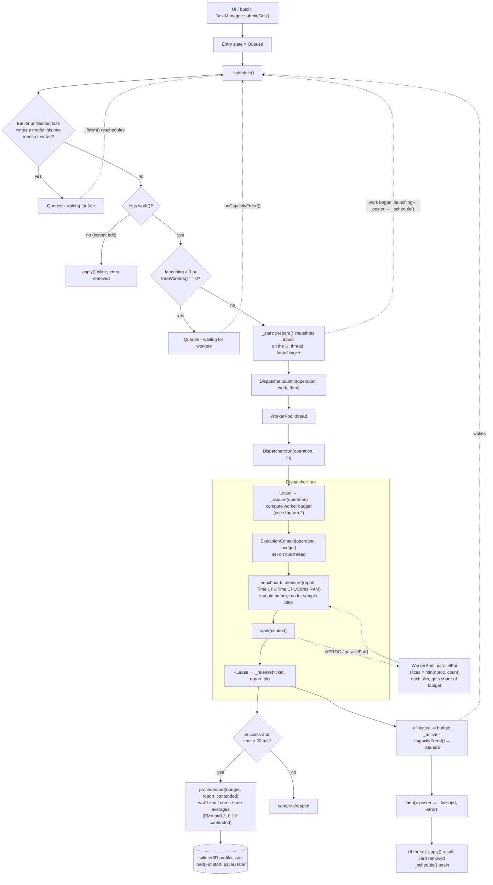
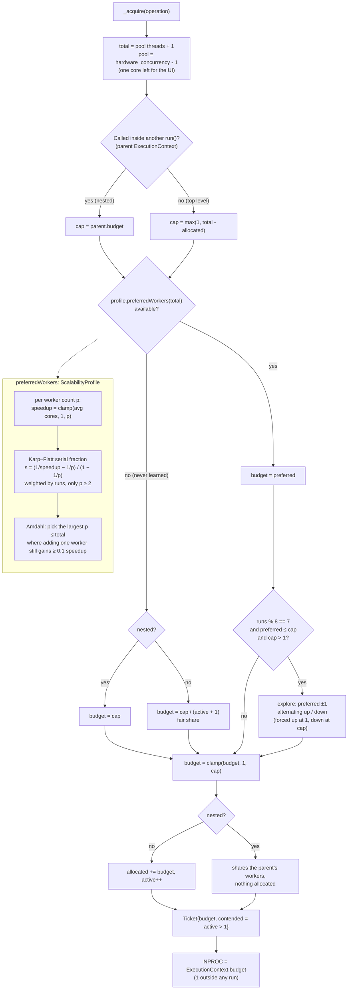

# Task dispatching

How a background task travels from the UI to a worker thread, and how the
`Dispatcher` decides how many workers (`NPROC`) it gets. Sources:

- `src/application/tasks/task_manager.{hpp,cpp}`: queueing and ordering
- `src/platform/threading/dispatcher.{hpp,cpp}`: worker budgets, profiles
- `src/platform/threading/scalability_profile.{hpp,cpp}`: learning how an operation scales
- `src/platform/threading/worker_pool.{hpp,cpp}`: `parallelFor`
- `src/platform/benchmark/benchmark.hpp`: `measure()`

## 1. Task dispatch workflow

## 2. NPROC / worker budget computation (`_acquire`)

## Notes

- `NPROC` is the `budget` of the current thread's `ExecutionContext`; it is 1
  outside any `run()`. `Dispatcher::run` sets the context from the ticket
  `_acquire` returns.
- An operation with no learned profile gets a fair share of the free workers,
  `cap / (active + 1)`. Once `ScalabilityProfile` has data, the worker count
  comes from Amdahl's law, and every 8th run tries one worker more or fewer
  (`kExploreEvery`).
- A top-level run that releases its workers fires `onCapacityFreed`, which wakes
  `TaskManager::_schedule` for tasks waiting for workers, whoever held them.
- Runs shorter than `kMinLearnedDuration` (20 ms) are not recorded: their CPU
  time mostly measures overhead.
